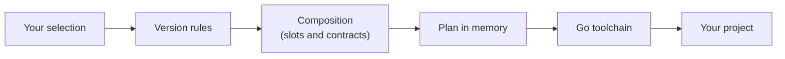

<div align="center">

# gobento

**Generate Go projects from the stack you choose — compatible versions, proven builds.**

[](https://github.com/Tales-of-zuna/gobento/actions/workflows/ci.yml)
[](https://pkg.go.dev/github.com/Tales-of-zuna/gobento)
[](https://goreportcard.com/report/github.com/Tales-of-zuna/gobento)
[](LICENSE)
[](https://github.com/Tales-of-zuna/gobento/releases)
[](#roadmap)

[Why gobento](#why-gobento) · [Usage](#usage) · [How it works](#how-it-works) · [Contributing](#contributing) · [Roadmap](#roadmap)

</div>

> [!NOTE]
> **gobento v0.1.0 is released.** It is an early, pre-1.0 release: the first
> stack works, but the interface may still change between minor releases. To
> follow what is being built, see the proposals in
> [`openspec/changes/`](openspec/changes).

## Why gobento?

- **Your stack, your choice.** Pick the architecture, HTTP framework, database,
  and data access library for a new project.
- **Versions you can trust.** Choose the Go and module versions you want. They
  are checked against compatibility rules kept as data, and gobento rejects
  combinations that do not work instead of silently changing them.
- **Composed, not copy-pasted.** An architecture defines slots with Go
  contracts between them, and components fill the slots. There is no template
  per combination, so adding a component does not multiply the work.
- **Proven builds.** Every supported combination is generated, built, and
  tested in CI on Linux, macOS, and Windows.
- **Built to stay current.** All versions live in one rules file, so keeping
  up with upstream releases is a one-line, reviewed change instead of a hunt
  through templates.

## Usage

You need [Go](https://go.dev/dl/) 1.26 or newer: gobento uses your Go
toolchain to fetch the exact dependency versions of the project it generates.
Install gobento with `go install`:

```sh
go install github.com/Tales-of-zuna/gobento/cmd/gobento@latest
gobento --version
```

v0.1.0 installed with `go install` reports its version as `dev`; release
binaries, and later releases installed with `go install`, report the version
number.

Or download a prebuilt binary for Linux, macOS, or Windows from
[GitHub Releases](https://github.com/Tales-of-zuna/gobento/releases), and verify
it against the release's `checksums.txt`:

```sh
gh release download v0.1.0 --repo Tales-of-zuna/gobento \
  --pattern 'gobento_0.1.0_linux_amd64.tar.gz' --pattern checksums.txt
sha256sum --check --ignore-missing checksums.txt   # macOS: shasum -a 256 --check --ignore-missing checksums.txt
tar -xzf gobento_0.1.0_linux_amd64.tar.gz gobento
```

The [installation guide](https://tales-of-zuna.github.io/gobento/docs/getting-started/installation/)
covers every platform, including Windows. To build from a clone instead, run
`make build` or `go install ./cmd/gobento`.

Generate a project. Choose the architecture with `--arch` (`mvc` organizes the
code by layer, `vertical-slice` by feature), the HTTP framework with
`--framework` (`nethttp`, `chi`, or `gin`), the database with `--db`
(`sqlite` or `postgres`), and the data access with `--data` (`sqlc` or
`gorm`). A component kind with a single option is chosen automatically, and
versions come from gobento's compatibility rules. In a terminal, gobento asks
for anything it still needs: run `gobento new` to be asked for the name,
module path, and each component kind with several options. Flags skip their
questions; in scripts and CI, name every kind with several options.

```sh
gobento new shop --module example.com/shop --arch mvc --framework nethttp --db sqlite --data sqlc
cd shop
go test ./...
go run ./cmd/shop
```

More examples:

```sh
# Organize the code by feature instead of by layer
gobento new shop --arch vertical-slice --framework nethttp --db sqlite --data sqlc

# Use GORM instead of sqlc for data access
gobento new shop --arch mvc --framework nethttp --db sqlite --data gorm

# Use PostgreSQL; the project's README shows how to start a local server
gobento new shop --arch mvc --framework chi --db postgres --data sqlc

# See the files gobento would create, without writing anything
gobento new shop --arch mvc --framework chi --db sqlite --data sqlc --dry-run

# Choose the Go version and a library version within the supported ranges
gobento new shop --arch mvc --framework gin --db sqlite --data sqlc --go 1.26 --pin modernc.org/sqlite=v1.61.0

# Fill the current directory, which must be empty
mkdir shop && cd shop && gobento new shop --arch mvc --framework nethttp --db sqlite --data sqlc --dir .

# Never ask a question (pipes and CI never get any either)
gobento new shop --arch mvc --framework nethttp --db sqlite --data sqlc --no-input

# List every flag
gobento new --help
```

Generation runs `go get` and `go mod tidy`, so it needs access to the Go module
proxy. gobento checks every input before writing anything, refuses non-empty
directories, and removes everything it created if a step fails or you press
Ctrl-C. After an interrupt it prints `interrupted; nothing was left behind`
and exits with status 130; the same goes for Ctrl-C or Esc at a question.
Set `ACCESSIBLE=1` for plain-text questions that work with screen readers.

Project names start with a lowercase letter and use only lowercase letters,
digits, `-`, and `_`. Names that Windows reserves for devices, such as `con`,
`nul`, `com1`, or `lpt1`, are rejected.

The generated project's README describes its API, including its error
responses (`400` for invalid JSON, `413` for bodies over 1 MiB), its database
and how to run the tests against it, and how its schema and data-access code
are maintained. With PostgreSQL, the database tests run when
`TEST_DATABASE_URL` names a server and are skipped otherwise, so
`go test ./...` passes anywhere.

The reference stack (`mvc`, `nethttp`, `sqlite`, `sqlc`) generates a project
like this, with a health endpoint and one example resource that builds and
passes its own tests:

```text
shop/
├── cmd/shop/main.go       # config from env, wiring, graceful shutdown
├── internal/
│   ├── models/            # domain types and store interface
│   ├── controllers/       # router, health and items handlers, tests
│   ├── database/          # opens SQLite or PostgreSQL, applies the embedded schema
│   │   └── dbtest/        # a fresh database for each test
│   └── store/             # sqlc queries, adapter, tests; generated code in sqlcgen/
├── sqlc.yaml
├── go.mod
├── go.sum
├── README.md
└── .gitignore
```

With `--arch vertical-slice`, the same components are arranged by feature:
everything about the example resource lives in one directory, and the
generated README explains how to add the next feature beside it.

```text
shop/
├── cmd/shop/main.go       # config from env, wiring, graceful shutdown
├── internal/
│   ├── items/             # the items feature: domain type and store interface
│   │   ├── itemshttp/     # router, health and items handlers, tests
│   │   └── itemsstore/    # sqlc queries, adapter, tests; generated code in sqlcgen/
│   └── platform/
│       └── database/      # opens SQLite, applies the embedded schema
├── sqlc.yaml
└── ...                    # go.mod, go.sum, README.md, .gitignore
```

With `--data gorm`, `internal/store/` holds a [GORM](https://gorm.io/) store
and its test instead, there is no `sqlc.yaml`, and the tables still come only
from the database's embedded schema (no `AutoMigrate`). Both stacks build
without cgo.

## How it works



- **Validate first.** Every input problem is reported at once, before anything
  is written to disk.
- **Resolve with Go itself.** The plan is written to a temporary directory, and
  the Go toolchain fetches the exact versions you chose. gobento then checks
  that nothing was raised behind your back.
- **Leave nothing behind.** gobento only fills a new or empty directory, and on
  any failure or Ctrl-C it cleans up after itself.

## Roadmap

- [x] First slice: MVC, `net/http`, SQLite, and sqlc (v0.1.0)
- [x] Interactive prompts
- [x] More frameworks: gin, chi
- [x] PostgreSQL
- [x] GORM
- [ ] Frontends: React, Vue, and Svelte via Vite; htmx + templ
- [ ] Tailwind CSS
- [x] More architectures: vertical slice
- [ ] More architectures: DDD
- [x] Releases with prebuilt binaries via GoReleaser (v0.1.0)

Have an idea? Open a
[feature request](https://github.com/Tales-of-zuna/gobento/issues/new?template=feature_request.yml)
or a
[component request](https://github.com/Tales-of-zuna/gobento/issues/new?template=component_request.yml).

## Contributing

Contributions of every size are welcome. [CONTRIBUTING.md](CONTRIBUTING.md)
covers the development setup, the OpenSpec workflow, and the pull request
process. Please follow the [Code of Conduct](CODE_OF_CONDUCT.md), and see
[SUPPORT.md](SUPPORT.md) if you have a question.

## Security

Please do not report vulnerabilities in public issues. See
[SECURITY.md](SECURITY.md) for how to report them privately.

## License

gobento is released under the [MIT License](LICENSE).

## Acknowledgements

gobento is inspired by [go-blueprint](https://github.com/melkeydev/go-blueprint),
which showed how much a good project generator helps Go developers get started.
Thank you to its authors and contributors.
