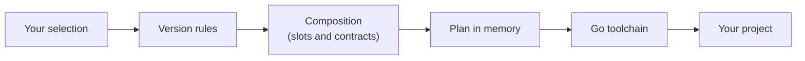

<div align="center">

# gobento

**Generate Go projects from the stack you choose — compatible versions, proven builds.**

[](https://github.com/Tales-of-zuna/gobento/actions/workflows/ci.yml)
[](https://pkg.go.dev/github.com/Tales-of-zuna/gobento)
[](https://goreportcard.com/report/github.com/Tales-of-zuna/gobento)
[](LICENSE)
[](#roadmap)

[Why gobento](#why-gobento) · [Planned usage](#planned-usage) · [How it works](#how-it-works) · [Contributing](#contributing) · [Roadmap](#roadmap)

</div>

> [!NOTE]
> gobento is in **early development** and **nothing is released yet**. The
> commands below show the planned interface, not a working tool. To follow what
> is being built, see the proposals in [`openspec/changes/`](openspec/changes).

## Why gobento?

- **Your stack, your choice.** Pick the architecture, HTTP framework, database,
  and data access library for a new project.
- **Versions you can trust.** Choose the Go and module versions you want. They
  are checked against compatibility rules kept as data, and gobento rejects
  combinations that do not work instead of silently changing them.
- **Composed, not copy-pasted.** An architecture defines slots with Go
  contracts between them, and components fill the slots. There is no template
  per combination, so adding a component does not multiply the work.
- **Proven builds.** Every supported combination is generated, built, and
  tested in CI on Linux, macOS, and Windows.
- **Built to stay current.** All versions live in one rules file, so keeping
  up with upstream releases is a one-line, reviewed change instead of a hunt
  through templates.

## Planned usage

> [!IMPORTANT]
> This is the **planned interface**. It does not work yet.

```sh
# Planned: install the CLI
go install github.com/Tales-of-zuna/gobento/cmd/gobento@latest

# Planned: generate a project
gobento new shop --module example.com/shop --arch mvc --framework nethttp --db sqlite --data sqlc
```

The first supported stack generates a project like this, with a health
endpoint and one example resource that builds and passes its own tests:

```text
shop/
├── cmd/shop/main.go       # config from env, wiring, graceful shutdown
├── internal/
│   ├── models/            # domain types and store interface
│   ├── controllers/       # router, health and items handlers, tests
│   ├── database/          # opens SQLite, applies the embedded schema
│   └── store/             # sqlc queries and generated code, tests
├── sqlc.yaml
├── go.mod
├── go.sum
├── README.md
└── .gitignore
```

## How it works



- **Validate first.** Every input problem is reported at once, before anything
  is written to disk.
- **Resolve with Go itself.** The plan is written to a temporary directory, and
  the Go toolchain fetches the exact versions you chose. gobento then checks
  that nothing was raised behind your back.
- **Leave nothing behind.** gobento only fills a new or empty directory, and on
  any failure or Ctrl-C it cleans up after itself.

## Roadmap

- [ ] First slice: MVC, `net/http`, SQLite, and sqlc
- [ ] Interactive prompts
- [ ] More frameworks: gin, chi
- [ ] PostgreSQL
- [ ] GORM
- [ ] Frontends: React, Vue, and Svelte via Vite; htmx + templ
- [ ] Tailwind CSS
- [ ] More architectures: vertical slice, DDD
- [ ] Releases with prebuilt binaries via GoReleaser

Have an idea? Open a
[feature request](https://github.com/Tales-of-zuna/gobento/issues/new?template=feature_request.yml)
or a
[component request](https://github.com/Tales-of-zuna/gobento/issues/new?template=component_request.yml).

## Contributing

Contributions of every size are welcome. [CONTRIBUTING.md](CONTRIBUTING.md)
covers the development setup, the OpenSpec workflow, and the pull request
process. Please follow the [Code of Conduct](CODE_OF_CONDUCT.md), and see
[SUPPORT.md](SUPPORT.md) if you have a question.

## Security

Please do not report vulnerabilities in public issues. See
[SECURITY.md](SECURITY.md) for how to report them privately.

## License

gobento is released under the [MIT License](LICENSE).

## Acknowledgements

gobento is inspired by [go-blueprint](https://github.com/melkeydev/go-blueprint),
which showed how much a good project generator helps Go developers get started.
Thank you to its authors and contributors.
